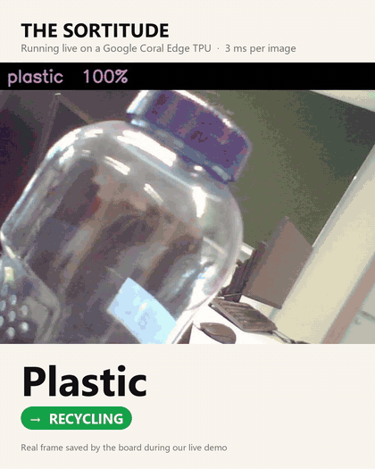
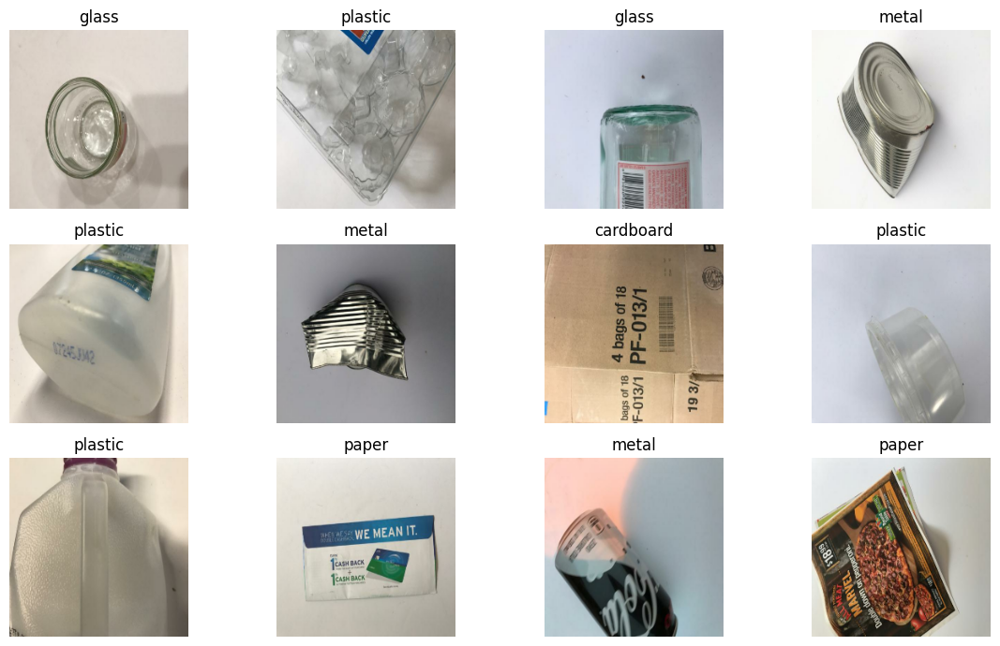
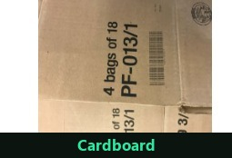
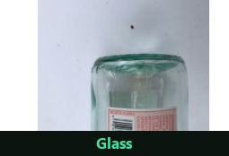
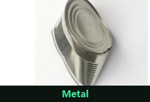
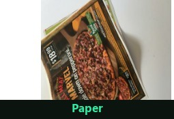
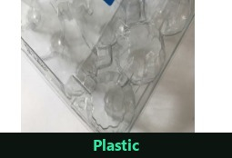
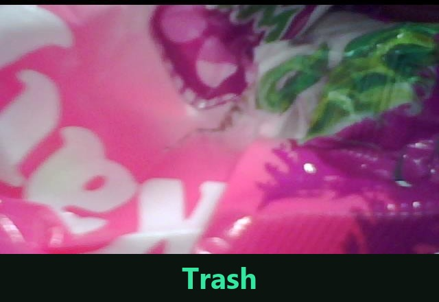

<div align="center">

# ♻️ The Sortitude

**AI-powered waste classification running live on a Google Coral Dev Board**
**— a camera looks at your trash and tells you which bin it belongs in, in 3 milliseconds**

[](https://python.org)
[](https://tensorflow.org)
[](https://www.tensorflow.org/lite)
[](https://coral.ai)
[](https://colab.research.google.com)

[](LICENSE)
[](LICENSE-docs)
[](https://doi.org/10.5281/zenodo.23590213)



<sub>Real frames saved by the board during our live demo · <a href="assets/demo.mp4">MP4 version</a></sub>

[The Idea](#-the-idea) · [What We Achieved](#-what-we-achieved) · [How It Works](#-how-it-works) · [Results](#-results) · [Live Demo](#%EF%B8%8F-live-demo) · [Try It](#-try-it-without-a-coral) · [Limitations](#%EF%B8%8F-limitations--whats-next) · [Repo Guide](#%EF%B8%8F-whats-in-this-repo)

</div>

---

## 💡 The Idea

Every day, tons of recyclable material end up in landfills simply because waste gets sorted into the wrong bin. Sorting by hand is boring, error-prone work — exactly the kind of job a machine should do.

**The Sortitude** is a small, self-contained device that does it: point a webcam at a piece of waste, and an AI model classifies it into one of six categories — **cardboard, glass, metal, paper, plastic, or trash** — and routes it to the *Recycling* or *Landfill* bin. No cloud, no internet connection, no big server. Everything runs on a credit-card-sized computer: the **Google Coral Dev Board** with its built-in **Edge TPU** AI chip.

> Built as a 3-person team project for the *Embedded AI* course at TH Rosenheim (Germany).

---

## 🏆 What We Achieved

| | Achievement | In plain words |
|---|---|---|
| 🧠 | **92.9% accurate model** | Trained an image classifier that gets ~9 out of 10 waste photos right |
| 🗜️ | **Shrunk the model 3.3×** | Compressed it from 8.5 MB to 2.6 MB so it fits comfortably on a tiny device — losing only ~3% accuracy |
| ⚡ | **3.09 ms per image** | The Edge TPU chip classifies an image **42× faster** than the board's own CPU (130.7 ms) |
| 📷 | **Live webcam demo** | A USB webcam on the board classifies whatever you hold up, in real time, at ~30 frames per second |
| 📊 | **Web dashboard** | A live control-room-style dashboard in the browser: video feed, prediction, confidence bars, bin routing, snapshots |
| 🔬 | **Honest experiments** | We also tried pruning (cutting 50% of the model's connections) — it failed completely (0% accuracy), and we documented why |

<div align="center">



</div>

---

## 🔧 How It Works

The journey from photos to a working device, in five steps:

```
 ┌────────────┐    ┌────────────┐    ┌────────────┐    ┌────────────┐    ┌────────────┐
 │  1. DATA   │ →  │  2. TRAIN  │ →  │ 3. COMPRESS│ →  │ 4. COMPILE │ →  │ 5. DEPLOY  │
 │  TrashNet  │    │ MobileNetV2│    │ Float32 →  │    │  Edge TPU  │    │ Coral board│
 │ 6 classes  │    │ in Colab   │    │ Int8 (2.6MB)│   │ all 67 ops │    │ + webcam + │
 │ ~2,500 imgs│    │ 92.9% acc. │    │ quantization│   │ on the TPU │    │  dashboard │
 └────────────┘    └────────────┘    └────────────┘    └────────────┘    └────────────┘
```

1. **Data** — We used **TrashNet**, a public dataset of ~2,500 photos of waste items across the six categories.
2. **Training** — Instead of training a network from scratch, we used **transfer learning**: we took **MobileNetV2** (a network Google pre-trained on millions of images) and taught it our six waste classes in Google Colab. Result: **92.87% validation accuracy**.
3. **Compression** — A tiny device can't run a big model. **Quantization** converts the model's numbers from 32-bit floats to 8-bit integers, shrinking it from **8.5 MB → 2.6 MB** while keeping **89.7%** accuracy.
4. **Compilation** — The `edgetpu_compiler` translates the model for the Edge TPU chip. All **67 operations** of our model run on the TPU — none fall back to the slow CPU.
5. **Deployment** — The model, a demo script, and a web dashboard run on the Coral board with a USB webcam. The board serves the dashboard over USB to a laptop browser.

### The hardware

| Part | Role |
|---|---|
| **Google Coral Dev Board** | The brain — quad-core ARM CPU + Edge TPU AI accelerator, runs Mendel Linux |
| **Edge TPU** | Google's tiny AI chip — performs 4 trillion operations/second using ~2 watts |
| **Microsoft LifeCam webcam** | The eye — USB camera capturing the live video feed |
| **Laptop** | Only used as a screen — connects over a USB cable to view the dashboard |

---

## 📈 Results

The heart of the assignment: compare model size vs. accuracy vs. speed across compression variants.

| Model variant | Size | Accuracy | Speed on device | Verdict |
|---|---|---|---|---|
| Float32 baseline | 8.49 MB | **92.87%** | — (too big/slow for TPU) | Reference |
| **Int8 quantized** | **2.59 MB** | **89.70%** | 130.7 ms (CPU) | ✅ The sweet spot |
| **Int8 + Edge TPU compiled** | 2.79 MB | 89.70% | **3.09 ms (TPU)** | 🏆 **Deployed** |
| Pruned 50% + Int8 | 2.59 MB | 0.00% | — | ❌ Failed — accuracy collapsed |

**Key numbers:**

- 🗜️ Quantization bought a **3.3× smaller model** for only **3.2 percentage points** of accuracy.
- ⚡ The Edge TPU runs inference **42.3× faster** than the board's CPU (3.09 ms vs 130.7 ms, averaged over 50 runs).
- 🎥 End-to-end with the webcam: **~30 FPS** — limited by the camera, not the AI. The model alone could do ~280 FPS.
- ⚠️ **Pruning failed honestly:** removing 50% of weights and then quantizing destroyed the model (0% accuracy). Lesson learned — pruning needs careful fine-tuning afterwards, and stacking aggressive compression techniques is not free.

Full numbers in [`models/sortitude_model_results.csv`](models/sortitude_model_results.csv); the pruning failure analysis is in [docs/PRUNED_MODEL_FIX.md](docs/PRUNED_MODEL_FIX.md).

---

## 🖥️ Live Demo

The board runs a **self-contained web dashboard** (pure Python standard library — no frameworks) that streams the camera feed and classification results to any browser:

- 📹 Live annotated video stream (MJPEG)
- 🏷️ Current prediction with confidence % and **Recycling / Landfill** bin routing
- 📊 Animated probability bars for all six classes
- ⏱️ Live stats: inference time, FPS, average confidence
- 📸 Snapshot button + automatic capture when the model is 100% confident

**The six categories the system sorts into** — original images from the TrashNet dataset:

<div align="center">

| Cardboard | Glass | Metal |
|:---:|:---:|:---:|
|  |  |  |

| Paper | Plastic | Trash |
|:---:|:---:|:---:|
|  |  |  |

</div>

### Running it on the board

```bash
# On the Coral board (over SSH), with the USB webcam plugged in:
bash ~/sortitude/start_dashboard.sh
# Then open http://<board-ip>:8000/ in a browser on the connected laptop
```

Full setup — compiling for the Edge TPU, deploying, troubleshooting — is in **[docs/SETUP.md](docs/SETUP.md)**.

---

## 🧪 Try It Without a Coral

```bash
pip install -r requirements.txt

# Classify an image on your laptop CPU with the int8 model
python board/demo.py --cpu --model models/sortitude_int8.tflite --labels models/labels.txt     --image samples/correct/plastic_bottle_1.jpg

# Preview the dashboard UI with simulated data (pure Python, no camera needed)
python mock/mock_dashboard_v2.py      # → http://localhost:8000
```

To retrain, open [`notebooks/Sortitude_Pipeline.ipynb`](notebooks/Sortitude_Pipeline.ipynb) in Google Colab — it downloads TrashNet, trains, and exports all model variants.

---

## ⚠️ Limitations & What's Next

We'd rather be upfront about where it breaks:

- **Lab photos vs. real rooms.** TrashNet is clean, single objects on white backgrounds. In a real room the model is much less reliable than its 89.7% validation score suggests — see [`samples/misclassified/`](samples/misclassified/).
- **It always picks one of six classes.** There is no "nothing here" option, so an empty wall gets labelled *paper*.
- **Overconfident.** The softmax saturates near 100% even when the prediction is wrong.
- **Pruning failed.** Pruning 50% + int8 collapsed to 0% accuracy ([post-mortem](docs/PRUNED_MODEL_FIX.md)).

Planned fixes — a background class, confidence gating and temporal smoothing, fine-tuning on real frames, and a portable backend for Raspberry Pi — are in [docs/IMPROVEMENT_PLAN.md](docs/IMPROVEMENT_PLAN.md). Hardware and dataset research for a next version is in [docs/NEXT_PHASE_RESEARCH.md](docs/NEXT_PHASE_RESEARCH.md).

---

## 🗂️ What's in This Repo

```
sortitude/
├── notebooks/Sortitude_Pipeline.ipynb  ← Colab notebook: data → training → compression
├── models/                             ← float32 / int8 / Edge TPU / pruned .tflite, labels, results CSV
├── board/                              ← runs on the Coral: dashboard, demo, webcam loop, benchmark
├── mock/mock_dashboard_v2.py           ← dashboard UI with simulated data (no hardware)
├── tools/                              ← Edge TPU compiler install + compile scripts (WSL2/Linux)
│   └── diagnostics/                    ← camera / USB / environment probes used while debugging
├── samples/                            ← real frames from the live demo (correct + misclassified)
├── assets/                             ← README images and demo clip
└── docs/                               ← setup guide, pruning post-mortem, roadmap, slides (PDF)
```

The original Keras model (`sortitude_baseline.keras`, 21 MB) is attached to the GitHub Release.

---

## 🛠️ Tech Stack

| Layer | Technology |
|---|---|
| Model | MobileNetV2 (transfer learning), TensorFlow / Keras |
| Compression | TensorFlow Lite post-training int8 quantization, pruning experiment |
| Edge compilation | `edgetpu_compiler` v16 (Google Coral toolchain) |
| On-device runtime | `tflite_runtime` + `pycoral` on Mendel Linux |
| Camera & imaging | OpenCV, PIL, uvcvideo |
| Dashboard | Pure Python `http.server` — zero external dependencies on the board |
| Training environment | Google Colab (GPU) |

---

## 👥 Team

Built by a team of three: **Abhi Faldu** ([@abhi-faldu](https://github.com/abhi-faldu)) · **Jeel Sidpara** ([@jeelsidpara2811](https://github.com/jeelsidpara2811)) · **Aatman Sabhaya** ([@Aatmanium](https://github.com/Aatmanium))

## 📝 Citation

If you use this code, the models or the results, please cite it. GitHub's **"Cite this repository"** button (from [`CITATION.cff`](CITATION.cff)) gives APA and BibTeX, or use:

```bibtex
@software{sortitude2026,
  author  = {Faldu, Abhi and Sabhaya, Aatman and Sidpara, Jeel},
  title   = {The Sortitude: Real-Time Edge AI Waste Classification on a Google Coral Edge TPU},
  year    = {2026},
  version = {1.0.1},
  doi     = {10.5281/zenodo.23590213},
  url     = {https://doi.org/10.5281/zenodo.23590213}
}
```

## 📄 License & Credits

- **Code and trained models:** [MIT License](LICENSE)
- **Documentation, figures, demo media and sample images** (`docs/`, `assets/`, `samples/`, this README): [CC BY 4.0](LICENSE-docs)
- Trained on [TrashNet](https://github.com/garythung/trashnet) by Gary Thung and Mindy Yang (MIT License); the dataset images shown here remain under that license.
- Scope and third-party exceptions are spelled out in [NOTICE.md](NOTICE.md).

---

<div align="center">
  <sub>Course project — Embedded AI, TH Rosenheim.<br>
  From a folder of trash photos to a working smart-bin prototype, entirely on a 2-watt chip.</sub>
</div>
